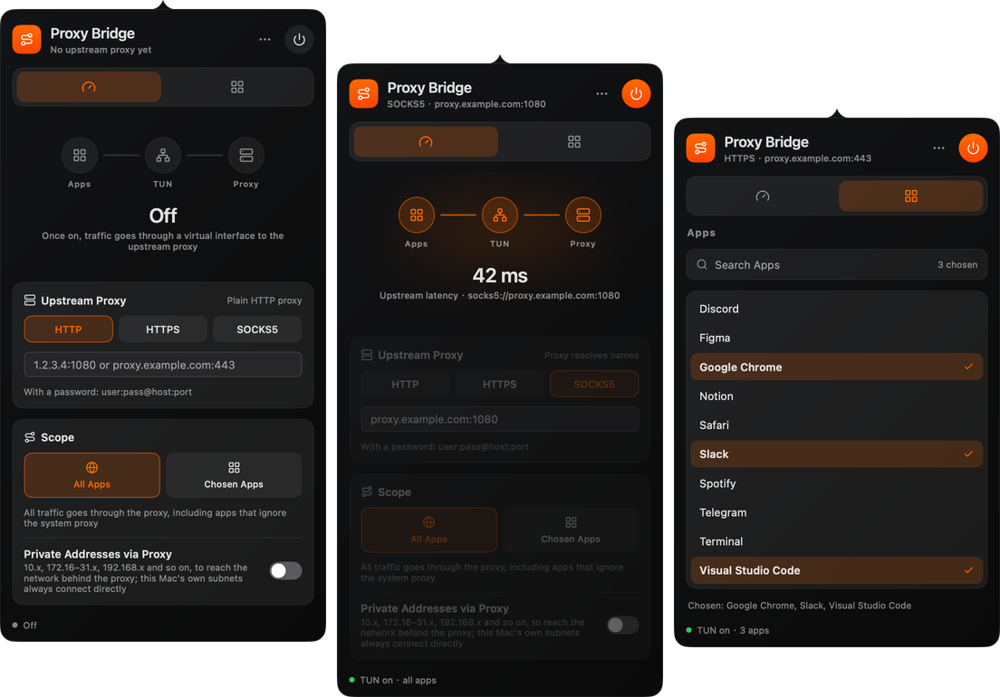

# Proxy Bridge

[简体中文](README.md) · English

Sends the traffic of **every app**, or of **the apps you choose**, on a Mac through an HTTP, HTTPS or SOCKS5 proxy, by a virtual network interface (TUN). It leaves the system proxy alone and needs nothing from the apps: native apps, apps that ignore the system proxy and command-line tools all go through it. It lives in the menu bar, styled after [MonitorBar](https://github.com/dcchanInSz/MonitorBar). Native UI in Go with [mygo](https://github.com/egoist/mygo); the TUN is a trimmed build of [sing-box](https://github.com/SagerNet/sing-box).



## Why

My proxy runs on a Mac mini at home, where Clash serves an HTTP and SOCKS5 proxy. My work computer, my phone, and devices like the Switch and the Apple TV just have that proxy in their network settings: none of them needs proxy software of its own, and most apps are fine with it.

Some apps ignore the system proxy, though. Antigravity, for one, sends part of its requests directly, around the system proxy, and only works with a global proxy (TUN mode). Installing and configuring a whole Clash on the work computer for that one app is too much.

Proxy Bridge does one thing: **it turns an HTTP, HTTPS or SOCKS5 proxy you already have into a TUN**. Type its address, turn it on, and apps that ignore the system proxy go through it too. Or send only apps like Antigravity through it, and let the rest connect directly.

If you already have a proxy (at home, at work, on a server) and just want a stubborn app to use it, this is what Proxy Bridge is for. It does not replace Clash: no nodes, rules or subscriptions, just one upstream.

## Install

Download the dmg from [Releases](https://github.com/Binaryify/proxy-bridge/releases) and drag Proxy Bridge to Applications. There are builds for Apple silicon only, and they are not notarized: if macOS says it cannot verify the developer the first time, click Open Anyway in System Settings › Privacy & Security. Later versions come as updates (checked daily, or with Check for Updates… in the panel's … menu or the menu bar icon's right-click menu); the first time you turn it on after an update, it asks for your password once more, to update its background service.

## Use

Click the menu bar icon to open the panel (it opens once at launch); right-click it to quit.

1. **Overview**: choose the type (HTTP, HTTPS or SOCKS5) and type `ip:port` or `domain:port`. With a password, `user:pass@host:port`; pasting `socks5://host:port` picks the type for you
2. Choose the scope:
   - **All Apps**: all traffic goes through the proxy
   - **Chosen Apps**: check them in the **Apps** tab, which lists the apps in `/Applications` and `~/Applications` (and one folder deep), to search and check several. Checked apps, with their helper processes, go through the proxy; the rest connect directly. Apps already running follow at once, without a restart, and so do changes made while on
3. Turn it on with the power button at the top right. **The first time**, the system asks for an administrator password once, to install a background service (creating a network interface takes root); after that, turning it on and off asks for nothing. While on, the power button and the menu bar icon light up, and the overview shows the latency of `https://www.gstatic.com/generate_204` through the proxy

The TUN keeps working with the panel closed; quitting from the right-click menu or the panel's … turns it off. To remove the background service, choose Uninstall Background Service… in the … menu.

The app speaks English and Simplified Chinese, following the system's language.

## How it works

```text
apps ──► utun (sing-box, background service) ──┬─ chosen apps / all ──► upstream proxy ──► destination
                                               └─ the rest ───────────► direct (on the physical interface)
```

- **Background service** (as Clash Verge's service mode): the first time it turns on, `osascript … with administrator privileges` copies the app's executable to `/Library/PrivilegedHelperTools/com.binaryify.proxybridge.helper` (owned by root, which users cannot change) and installs a LaunchDaemon (`/Library/LaunchDaemons/com.binaryify.proxybridge.helper.plist`) that runs it as root, from boot. The app then talks to it over `/var/run/com.binaryify.proxybridge.helper.sock`, with no password.
  - **Only you, and this copy of the app**: the socket belongs to the user who installed it, mode 0600; each connection is also checked with `LOCAL_PEERCRED` and `LOCAL_PEERPID`, for the user and for the executable, which must be the copy of the app it was installed from
  - **Few commands**: start the TUN (upstream, all or not, the apps), change the apps, and closing the connection stops it. No paths, no commands; the service writes the sing-box configuration itself
  - **Its version follows the app's**: the service greets the app with the SHA-256 of its executable; when it differs from the app's at launch (an update, a move), the app installs it again, asking for the password once more. When the app's file is replaced while it runs, it does not install the new one: it asks to be opened again
  - **No UI as root**: run as root, the executable takes only `--service`, and otherwise exits
  - **Fail-safe**: one connection, one session; when the app quits or crashes, the service takes the TUN down at once, and when the service is killed, the interface and its routes go with it
  - Errors are logged to `/Library/Logs/Proxy Bridge Helper.log`
- **Per-app routing**: sing-box looks up the executable of each connection's process and matches `^/Applications/Some\ App\.app/`, helpers in `Contents/Frameworks/…Helper.app` included. The apps are a rule-set file in the service's private temporary directory, which sing-box reloads as it changes: no restart, no dropped connections
- **DNS**: the TUN takes the system's DNS and answers A and AAAA queries with fake IPs (`198.18.0.0/15`), turned back into names as apps connect: through the proxy, the proxy resolves the name, whatever local DNS says; directly, this Mac's DNS does
- **QUIC**: UDP 443 through the proxy is refused, and browsers fall back to TCP (HTTP proxies cannot carry UDP)
- **Private addresses**: the Private Addresses via Proxy switch in the scope decides whether private addresses (`10.0.0.0/8`, `172.16.0.0/12`, `192.168.0.0/16`…) go through the proxy or directly. Turn it on to reach the network behind the proxy (say, SSH to `10.0.4.15`); it is off by default, as a system proxy's bypass list leaves them. This Mac's own subnets, Tailscale and other more specific routes never enter the TUN

## Limits

- The background service stays running as root (doing nothing while the TUN is off); macOS says a background item was added as it installs, listed in System Settings › General › Login Items & Extensions. Uninstall it from the … menu when you no longer need it
- Requests system services make for apps cannot be told apart by app (`nsurlsessiond` background downloads, iCloud sync…), and count as the rest
- With an HTTP or HTTPS upstream, UDP other than QUIC (games, calls) cannot go through the proxy; with SOCKS5, it depends on the server
- After the TUN goes off, an app may hold on to fake IPs for a moment, and connect again once its DNS cache expires
- macOS only

## Build

Go 1.27 or later; mygo is a Go tool dependency.

To release a version, change `version` in `mygo.json`, describe it in `CHANGELOG.md`, and build and upload with the key that signs updates (made by `mygo keygen`, in `~/Library/Application Support/mygo/update-keys/`; keep it out of the repository, as installed apps take updates signed with it only):

```bash
MYGO_UPDATER_PRIVATE_KEY="$(cat ~/Library/Application\ Support/mygo/update-keys/mygo-update.key)" go tool mygo build -upload
```

This makes a draft release; once published on GitHub, installed apps find it.

```bash
go tool mygo dev          # develop, restarting as the code changes
go test -race ./...       # unit tests, UI tests without a window, sing-box configurations
go tool mygo vet .        # mygo's checks of element lifetimes
go tool mygo build        # build/darwin-arm64/Proxy Bridge.app, and a dmg
PROXYBRIDGE_SNAPSHOTS=/tmp/shots go test -run Snapshots .                         # draw the panel and the icon
PROXYBRIDGE_SNAPSHOTS=/tmp/shots PROXYBRIDGE_LOCALE=en go test -run Snapshots .   # in English
```

### Languages

The app's messages are in `locales/`, a JSON file per language (`en.json`, the source, and `zh-Hans.json`), in ICU MessageFormat. `go tool mygo dev` and `go tool mygo build` write `locales/catalog_gen.go` from them, a function per message. To add a language, add `locales/<tag>.json` (such as `ja.json`) with every key of `en.json`, then run `go tool mygo generate`; `TestCatalogs` checks that the catalogs have the same keys.

## Layout

```text
main.go             the menu bar icon and panel; with --service, the root background service; the real system
app.go              state and flow: on and off, the chosen apps, the settings
view.go             the panel: header, tabs, overview, app list, status
style.go            MonitorBar's colors, cards, chips and icons
locales/            the messages in each language, and their generated functions
internal/tun        the sing-box configuration, the root service (install, uninstall, peer checks), sessions between app and service
internal/apps       the installed apps
internal/upstream   parsing the proxy's address
```

UI state changes on the main thread only; background work (the password, the TUN starting, the service's events) comes back through `app.post`. What touches the system goes through the `system` and `session` interfaces, which tests replace. The tests of `internal/tun` run the real service and session protocol in the test process (a temporary socket, a fake engine): installing, reinstalling another version, peer checks, a canceled password; they check the root scripts' syntax, the launchd plist and the AppleScript, and load every sing-box configuration (all but creating the interface, which takes root).

## License

[GPL-3.0](LICENSE). Proxy Bridge includes [sing-box](https://github.com/SagerNet/sing-box) (GPL-3.0), so the whole program is released under GPL-3.0: whoever distributes builds must offer the source too.

The look and the panel's structure come from [MonitorBar](https://github.com/dcchanInSz/MonitorBar); the UI framework is [mygo](https://github.com/egoist/mygo) (MIT).
