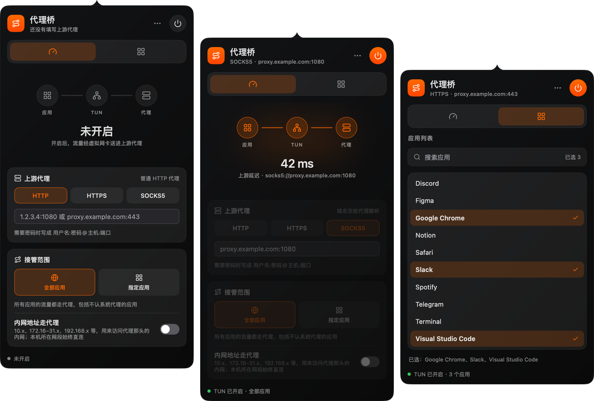

# 代理桥 · Proxy Bridge

用虚拟网卡（TUN）把 Mac 上**全部应用**或**选中应用**的流量送进一个 HTTP / HTTPS / SOCKS5 代理。不改系统代理，不需要应用配合：原生应用、不认系统代理的程序、命令行工具都能接管。常驻菜单栏，界面风格同 [MonitorBar](https://github.com/dcchanInSz/MonitorBar)。Go + [mygo](https://github.com/egoist/mygo) 原生 UI，TUN 内核是精简编译的 [sing-box](https://github.com/SagerNet/sing-box)。



## 为什么做这个

我的代理在家里的 Mac mini 上：那台机器开着 Clash，对外提供 HTTP / SOCKS5 代理。公司电脑、手机，还有 Switch、Apple TV 这些设备，都只在网络设置里填上这个代理，不用各自再装代理软件就能用，大部分软件也都够用了。

但有些软件不认系统代理，比如 Antigravity：它有一部分请求自己直接发出去，绕开了系统代理，只有开全局代理（TUN 模式）才能正常用。为了这一个软件在公司电脑上再装、再配一整套 Clash，太重了。

代理桥只做一件事：**把一个现成的 HTTP / HTTPS / SOCKS5 代理变成 TUN**。填上地址，点开启，不认系统代理的软件也会走这个代理。也可以只让 Antigravity 这类软件走代理，别的照常直连。

如果你手上已经有一个代理（家里的、公司的、云服务器上的），只是想让某个"不听话"的软件也用上它，代理桥就是为这个场景做的。它不是 Clash 的替代品：没有节点、规则和订阅，只接一个上游。

## 安装

从 [Releases](https://github.com/Binaryify/proxy-bridge/releases) 下载 dmg，把「Proxy Bridge」拖进「应用程序」。目前只有 Apple 芯片的构建，且未经 Apple 公证：第一次打开若提示无法验证开发者，在「系统设置 › 隐私与安全性」里点「仍要打开」。之后的版本由应用自己更新（每天检查一次，也可以在面板「…」或菜单栏图标右键里「检查更新…」）；每次更新后第一次开启会再问一次密码，用来更新后台服务。

## 用法

点菜单栏的图标打开面板（启动时会自动打开一次），右键图标可以退出。

1. **概览**页：选类型（HTTP / HTTPS / SOCKS5），填 `ip:端口` 或 `域名:端口`。需要密码写成 `用户名:密码@主机:端口`；直接粘贴 `socks5://host:port` 会自动选好类型
2. 选接管范围：
   - **全部应用**：所有流量走代理
   - **指定应用**：到 **应用列表** 页勾选。列出 `/Applications` 和 `~/Applications`（含一层子文件夹）里的应用，可搜索、可多选。勾选的应用连同它的辅助进程走代理，其余直连。已经在运行的应用立即生效，不用重启；开启后增减勾选也立即生效
3. 点右上角的电源按钮开启。**第一次**会弹一次系统密码框，安装后台服务（创建虚拟网卡需要 root）；之后开关都不再要密码。开启后电源按钮和菜单栏图标点亮，概览页显示经代理访问 `https://www.gstatic.com/generate_204` 的延迟

面板关掉后 TUN 继续工作；从右键菜单或面板的「…」退出时关闭 TUN。不用了可以在「…」里选「卸载后台服务…」。

## 原理

```text
应用 ──► 虚拟网卡 utun（sing-box，root 辅助进程）──┬─ 勾选的应用 / 全部 ──► 上游代理 ──► 目标
                                                   └─ 其余、局域网 ─────────► 直连（绑定物理网卡）
```

- **后台服务**（和 Clash Verge 的「服务模式」同一思路）：第一次开启时，经 `osascript … with administrator privileges` 把本程序复制到 `/Library/PrivilegedHelperTools/com.binaryify.proxybridge.helper`（root 所有，普通用户改不了），装一个 LaunchDaemon（`/Library/LaunchDaemons/com.binaryify.proxybridge.helper.plist`），以 root 常驻、开机自启。之后应用只通过 `/var/run/com.binaryify.proxybridge.helper.sock` 跟它说话，不再需要密码。
  - **只认你和这份代理桥**：socket 归安装的用户、权限 0600；每个连接再用 `LOCAL_PEERCRED` / `LOCAL_PEERPID` 核对对方的用户和可执行文件路径，必须是安装时的那份代理桥
  - **指令极少**：只有"开 TUN（上游地址、是否全部、应用列表）"、"改应用列表"和断开即关。没有路径、命令之类的字段；sing-box 配置由服务自己生成
  - **版本跟着应用走**：服务打招呼时报上自己可执行文件的 SHA-256，和应用启动时的不一致（升级了、换了位置）就重新安装，再问一次密码。应用运行中磁盘上的程序被替换时，不会去装新的那份，而是提示重新打开代理桥
  - **界面不以 root 运行**：程序以 root 身份启动时只接受 `--service`，否则直接退出
  - **兜底**：一个连接一个会话，应用退出或崩溃时连接断开，服务立即关掉 TUN；服务自己被杀，虚拟网卡和路由也随进程消失
  - 错误日志在 `/Library/Logs/Proxy Bridge Helper.log`
- **按应用分流**：sing-box 对每个连接反查所属进程的可执行文件路径，匹配 `^/Applications/某应用\.app/`（包括 `Contents/Frameworks/…Helper.app` 里的辅助进程）。应用列表写在辅助进程私有临时目录的规则集文件里，改动后 sing-box 自动重新加载，不重启、不断开已有连接
- **DNS**：TUN 接管系统 DNS，A/AAAA 查询返回 fake-ip（`198.18.0.0/15`），连接时再还原成域名：走代理的连接把域名交给代理解析，不受本地 DNS 污染影响；直连的由本机 DNS 解析
- **QUIC**：走代理的 UDP 443 会被拒绝，浏览器自动退回 TCP（HTTP 代理传不了 UDP）
- **内网地址**：「接管范围」里的「内网地址走代理」开关决定私有地址（`10.0.0.0/8`、`172.16.0.0/12`、`192.168.0.0/16` 等）走代理还是直连。打开它可以经代理访问代理那头的内网（比如 SSH 到 `10.0.4.15`）；默认关闭，和系统代理的绕过列表一样直连。本机所在网段、Tailscale 等有更具体路由的地址始终不进 TUN

## 限制

- 后台服务以 root 常驻（不开 TUN 时什么也不做）；安装时 macOS 会提示「已添加后台项目」，可在「系统设置 › 通用 › 登录项与扩展」里看到。不需要时在「…」里卸载
- 系统服务代替应用发的请求认不到具体应用（如 `nsurlsessiond` 的后台下载、iCloud 同步），按"其余流量"处理
- 上游是 HTTP / HTTPS 时，被代理应用的非 QUIC UDP（游戏、语音）无法通过；SOCKS5 取决于服务器是否支持 UDP
- 关闭 TUN 后，个别应用可能还缓存着 fake-ip，短时间连不上，DNS 缓存过期后恢复
- 只支持 macOS

## 构建

需要 Go 1.27+，mygo 作为 Go tool 依赖。

发布新版本：改 `mygo.json` 的 `version`，在 `CHANGELOG.md` 写上这个版本的说明，然后带着更新签名私钥打包上传（私钥由 `mygo keygen` 生成，存在 `~/Library/Application Support/mygo/update-keys/`，不要放进仓库，丢了已安装的应用就收不到更新）：

```bash
MYGO_UPDATER_PRIVATE_KEY="$(cat ~/Library/Application\ Support/mygo/update-keys/mygo-update.key)" go tool mygo build -upload
```

它会建一个草稿 Release，在 GitHub 上发布后，已安装的应用就能检查到。

```bash
go tool mygo dev          # 开发，改代码自动重启
go test -race ./...       # 单元测试 + 无窗口 UI 测试 + sing-box 配置加载测试
go tool mygo vet .        # mygo 的元素生命周期检查
go tool mygo build        # 打包 build/darwin-arm64/Proxy Bridge.app（+ dmg）
PROXYBRIDGE_SNAPSHOTS=/tmp/shots go test -run Snapshots .   # 面板和菜单栏图标的离屏截图
```

## 结构

```text
main.go             菜单栏图标与面板；--service 时作为 root 后台服务运行；真实的系统实现
app.go              状态与流程：开启/关闭、勾选应用、设置保存
view.go             面板：头部、标签页、概览、应用列表、底部状态
style.go            MonitorBar 的配色、卡片、按钮与图标
internal/tun        sing-box 配置、root 后台服务（安装/卸载/对端核验）、应用与服务之间的会话
internal/apps       列出已安装应用
internal/upstream   解析代理地址
```

UI 状态只在主线程改；后台任务（等密码、启动 TUN、辅助进程的事件）通过 `app.post` 送回主线程。系统相关操作都在 `system` / `session` 接口后面，测试用假实现替换；`internal/tun` 的测试在测试进程里跑真实的服务和会话协议（临时 socket、假引擎），覆盖安装、版本不符重装、对端核验、取消密码等情况，检查 root 脚本语法、launchd plist 和 AppleScript，并让 sing-box 真实加载每种配置（只差需要 root 的建网卡一步）。

## 许可证

[GPL-3.0](LICENSE)。代理桥内置了 [sing-box](https://github.com/SagerNet/sing-box)（GPL-3.0），所以整个程序以 GPL-3.0 发布，分发编译好的程序时须一并提供源码。

界面风格与面板结构来自 [MonitorBar](https://github.com/dcchanInSz/MonitorBar)；UI 框架为 [mygo](https://github.com/egoist/mygo)（MIT）。
